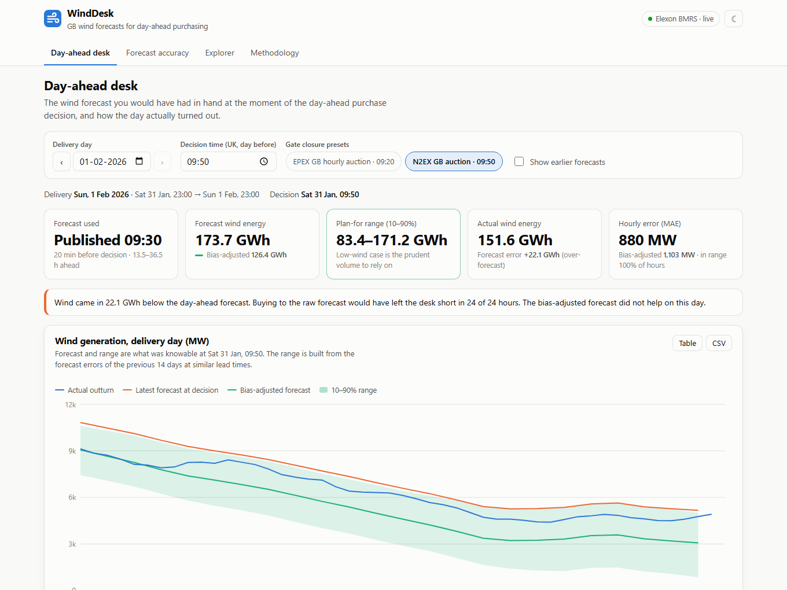

# WindDesk: GB wind forecast monitor for day-ahead purchasing

WindDesk is a pilot web app for a UK utility's day-ahead power purchasing team. It shows the national wind
forecast that was **actually available when each day-ahead purchase decision was made**. It also measures how
accurate those forecasts were, so the desk can buy with the error in mind.

| | |
|---|---|
| **Web app (Vercel)** | `https://<your-vercel-app>.vercel.app` ← replace after deploying |
| **API (Heroku)** | `https://<your-heroku-app>.herokuapp.com/docs` ← replace after deploying |
| **Video walkthrough** | `https://youtu.be/<video-id>` ← replace after uploading |

> **AI tools used.** This project was built with the help of an AI coding assistant (Claude Code by Anthropic).
> It was used for code generation, for researching the Elexon BMRS APIs and GB day-ahead market rules, and
> for drafting documentation. All code was reviewed, run and tested locally, and the analysis was checked
> against the live Elexon data.



---

## Contents

1. [What the product does](#what-the-product-does)
2. [Headline findings, January 2026](#headline-findings-january-2026)
3. [Quick start](#quick-start)
4. [Files and directories](#files-and-directories)
5. [Architecture](#architecture)
6. [API](#api)
7. [Analysis methodology](#analysis-methodology)
8. [Deployment (Heroku + Vercel)](#deployment-heroku--vercel)
9. [Configuration](#configuration)
10. [Development practices](#development-practices)
11. [Limitations and next steps](#limitations-and-next-steps)

---

## What the product does

| View | Question it answers |
|---|---|
| **Day-ahead desk** | "For delivery day D, what wind forecast did I have at my decision time on D-1, how uncertain was it, and what actually happened?" It shows the latest forecast at the decision time (default: N2EX gate closure, 09:50 UK), a bias-adjusted forecast, a 10–90% range, and the earlier forecast vintages. Hourly data downloads as CSV. |
| **Forecast accuracy** | "How good were those forecasts across every January decision?" It shows MAE, RMSE, bias, WAPE and error percentiles, plus daily energy error, error by lead time, a "does waiting help?" decision-time profile, the error distribution, forecast-vs-actual and error by hour of day. Key findings are generated from the data. |
| **Explorer** | "Show me actuals against the latest forecast that was at least *N* hours old." It has a free date range and a 0–48 h lead-time slider. |
| **Methodology** | Definitions, assumptions and limitations, written for the desk. |

Every chart has a table view, and all times are shown in UK local time.

## Headline findings, January 2026

These figures come from decisions made in January 2026 at the 09:50 N2EX gate closure (744 delivery hours,
2 Jan – 1 Feb).

| | Raw forecast | Bias-adjusted (no look-ahead) |
|---|---|---|
| Mean absolute error | 1,991 MW | **1,559 MW (−22%)** |
| RMSE | 2,493 MW | 2,030 MW |
| Bias (forecast − actual) | +1,727 MW | +746 MW |
| WAPE | 17.6% | 13.8% |
| Σ \|daily energy error\| | 1,334 GWh | 973 GWh (−27%) |

* **The forecast is systematically high.** It over-stated wind on 27 of 31 days, by 15% of mean output. The
  bias persists even 0–4 h ahead (≈ +1.5 GW), so it is structural rather than a question of forecast freshness.
* **The 10–90% range is well calibrated.** It contained the outcome in 80.5% of hours (target 80%).
* **Timing matters little.** Deciding at 09:50 (N2EX) rather than 09:20 (EPEX) uses the 09:30 forecast instead
  of the 07:30 one, which lowers MAE by only 1.4%.
* **Tail risk is real.** On 28 Jan the forecast was 270.8 GWh against an actual of 142.5 GWh. Even the low-wind
  case missed it.

## Quick start

### Docker (recommended)

```bash
docker compose up --build
```

* Web app: <http://localhost:3000>
* API and interactive docs: <http://localhost:8000/docs>

The API fetches the January 2026 data live from Elexon at start-up, which takes about 5 s. If Elexon is
unreachable it falls back to the bundled snapshot. To run fully offline:
`DATA_SOURCE=snapshot docker compose up --build`.

### Without Docker

Requirements: Python 3.12+ and Node 20+.

```bash
# API
cd backend
python -m venv .venv && source .venv/bin/activate      # Windows: .venv\Scripts\activate
pip install -r requirements-dev.txt
uvicorn app.main:app --reload                          # http://localhost:8000/docs

# Web app (second terminal)
cd frontend
npm install
npm run dev                                            # http://localhost:5173 (proxies /api to :8000)
```

### Tests

```bash
cd backend && ruff check app tests scripts && pytest     # 44 tests
cd frontend && npm test                                  # 7 tests
# or with Docker only:
docker build --target test -t winddesk-test backend && docker run --rm winddesk-test
```

## Files and directories

```
.
├── backend/                     FastAPI service (Python 3.12)
│   ├── app/
│   │   ├── main.py              App factory: CORS, gzip, lifespan (starts the background data load)
│   │   ├── api.py               HTTP routes and input validation (thin layer)
│   │   ├── service.py           Builds response payloads from the dataset; memoised per request params
│   │   ├── analysis.py          Pure pandas core: forecast selection, metrics, profiles, bias band
│   │   ├── market.py            GB day-ahead calendar: delivery windows, decision times, UK time/DST
│   │   ├── dataset.py           Scope windows, live load vs snapshot, snapshot read/write
│   │   ├── elexon.py            Async Elexon BMRS client (chunking, concurrency, retries) + parsing
│   │   ├── store.py             Process-lifetime data holder; readiness / 503 while loading
│   │   ├── schemas.py           Pydantic response models (drive the OpenAPI docs)
│   │   └── config.py            Settings from environment variables
│   ├── tests/                   pytest: market calendar, analysis rules, Elexon client, API endpoints
│   ├── scripts/build_snapshot.py  Regenerates data/snapshot.json.gz from Elexon
│   ├── data/snapshot.json.gz    Offline copy of the in-scope Elexon data (165 KB)
│   ├── Dockerfile               Multi-stage: base → test (lint + pytest) → runtime (non-root, $PORT)
│   ├── Procfile, .python-version  For the optional Heroku buildpack deploy
│   ├── requirements*.txt, pyproject.toml (pytest + ruff config), .env.example
├── frontend/                    React 18 + Vite single-page app
│   ├── src/
│   │   ├── App.jsx              Shell: header, tabs (hash-routed), theme toggle, API warm-up state
│   │   ├── views/               DayAhead, Accuracy, Explorer, Methodology
│   │   ├── components/ui.jsx    Stat tiles, chart cards (chart/table toggle + CSV), legend, tooltip
│   │   ├── lib/                 api.js (fetch + 503 retry), useApi.js, format.js (UK time), csv.js, tests
│   │   └── styles.css           Design tokens (light/dark), layout
│   ├── Dockerfile, nginx.conf   Static build served by nginx (docker-compose)
│   ├── vercel.json              Vercel build settings (root directory = frontend)
│   └── package.json, vite.config.js, .env.example
├── docs/
│   ├── screenshots/             Images used in this README
│   └── VIDEO_SCRIPT.md          Outline for the two-part demo video
├── heroku.yml                   Heroku container build: backend/Dockerfile
├── docker-compose.yml           Full stack locally
└── .github/workflows/ci.yml     CI: backend lint+tests, frontend tests+build, docker builds
```

## Architecture

```
 Browser ── React SPA (Vercel CDN)
    │  GET /api/... (JSON, gzip)
    ▼
 FastAPI on Heroku (Docker container)
    api.py ──► service.py ──► analysis.py (pure)    market.py (UK calendar)
                  ▲
               store.py ── background load at start-up; 503 + Retry-After until ready
                  ▲
               dataset.py ──► elexon.py ──► Elexon BMRS  FUELHH (fuelType=WIND), WINDFOR
                  └─────────► data/snapshot.json.gz  (fallback / offline)
```

**Key design decisions**

1. **Load once, serve from memory.** The scope is a fixed historical month, about 2.2k actuals and 22k forecast
   rows. A database would add operations work without adding value. Each result is a pure function of its
   query parameters over immutable data, so it is memoised (`lru_cache`). Repeat responses take
   milliseconds.
2. **Non-blocking start-up.** Data loads in a background task, so Uvicorn binds `$PORT` immediately (Heroku
   allows 60 s). Requests wait up to 25 s, below Heroku's 30 s router limit, then return
   `503 Retry-After`. The frontend retries and tells the user the service is waking up.
3. **Point-in-time correctness.** Forecast selection uses `pandas.merge_asof` keyed by target hour with
   `publish_time ≤ cutoff`. The bias adjustment and range use only errors whose outcome was known before the
   decision. Tests assert this with no look-ahead.
4. **Domain logic is isolated and tested.** `market.py` encodes the GB day-ahead calendar (23:00–23:00 UK
   delivery day, decisions on D-1) with DST-aware conversions. `analysis.py` has no I/O.
5. **Resilience.** The Elexon client splits the time range into 14-day chunks, fetches them concurrently and
   retries 5xx/429/network errors with backoff. A 165 KB snapshot keeps the demo working if Elexon is down.
6. **Typed contract.** Pydantic response models validate every payload and generate OpenAPI docs at `/docs`.
7. **Frontend kept simple.** The frontend has no state library. A small `useApi` hook keeps the previous data
   while refetching, so charts dim instead of flashing. Every chart has a table twin. Colours come from a
   CVD-validated palette (blue = actual, orange = forecast, aqua = adjusted) with a dedicated dark mode.

## API

All timestamps are ISO-8601 UTC. Power is in MW and energy in MWh. Error = forecast − actual.

| Endpoint | Purpose |
|---|---|
| `GET /api/health` | Liveness and data-load status (`ready` / `loading` / `error`) |
| `GET /api/meta` | Scope, defaults, publish schedule, data coverage |
| `GET /api/day-ahead?delivery_date=2026-01-15&decision_time=09:50` | One delivery day: half-hourly actuals, the forecast used, the bias-adjusted forecast and 10–90% range, energy summary and metrics, earlier vintages |
| `GET /api/accuracy?mode=day_ahead&decision_time=09:50` | Month-level metrics, raw and adjusted, plus daily, by-hour, histogram and scatter data |
| `GET /api/accuracy?mode=horizon&horizon_hours=24` | Same, for "latest forecast at least N h old" |
| `GET /api/accuracy/horizon-profile` | Error by lead time (0–47 h), using every forecast vintage |
| `GET /api/accuracy/decision-time-profile` | Day-ahead MAE if deciding at each half-hour of D-1 |
| `GET /api/explorer?start=2026-01-10T00:00&end=2026-01-17T00:00&horizon_hours=4` | Actual vs forecast for a range (naive times are UK local) |

## Analysis methodology

* **Data.** Elexon BMRS `FUELHH` (half-hourly outturn, `fuelType=WIND`) and `WINDFOR` (hourly forecasts, published
  8×/day at 02:30, 04:30, 07:30, 09:30, 11:30, 15:30, 18:30 and 22:30 UK in January). Each WINDFOR publication
  also repeats about 24 h of already-elapsed hours. Those rows have negative lead time, are not forecasts and
  are dropped.
* **Scope.** The scope is "purchase decisions made in January 2026". A decision on D-1 buys for delivery day D,
  so delivery days run from 2 Jan to 1 Feb. A GB day-ahead delivery day runs 23:00 (D-1) → 23:00 (D) UK time.
  No forecast published after 31 Jan is used. The only extra history loaded is 14 days before 1 Jan, because
  the error model needs past errors at the first decision.
* **Which forecast counts.** For each delivery hour, the most recent forecast published at or before the
  decision time (default 09:50 UK on D-1). In the Explorer and "fixed lead time" mode, the cut-off is N hours
  before the hour instead.
* **Comparison.** MW metrics compare forecasts and actuals at matching on-the-hour timestamps. Daily energy
  integrates each series at its native resolution (forecast hourly, actual half-hourly).
* **Metrics.** MAE, RMSE, bias, WAPE (Σ|e| / Σactual, used instead of MAPE, which explodes at low wind),
  |error| percentiles, signed-error percentiles and correlation.
* **Bias adjustment and 10–90% range.** At each decision, take the residuals (actual − forecast) whose outcome
  was already known: the previous 14 days, at lead times within ±3 h of the target hour. The adjusted forecast is
  forecast + median residual. The range is forecast + the 10th and 90th percentile residuals. Its realised
  coverage (80.5%) is reported, so calibration can be checked.

## Deployment (Heroku + Vercel)

One GitHub repository, two platforms: the backend runs as a Docker container on Heroku and the frontend is a
static build on Vercel.

### 1. Backend → Heroku (container stack, uses `heroku.yml`)

```bash
heroku login
heroku create <your-heroku-app>
heroku stack:set container -a <your-heroku-app>
heroku git:remote -a <your-heroku-app>
git push heroku main                      # builds backend/Dockerfile via heroku.yml
heroku open -a <your-heroku-app>          # → /, then /docs and /api/health
```

Alternatively, use the Heroku dashboard: **Deploy → GitHub → connect this repo → Enable automatic deploys**,
after running `stack:set container` once. `heroku.yml` is picked up automatically.

Once the frontend URL is known, restrict CORS (optional; the default `*` is fine for this public read-only
API):

```bash
heroku config:set CORS_ORIGINS=https://<your-vercel-app>.vercel.app -a <your-heroku-app>
```

<details><summary>Alternative: Python buildpack instead of Docker</summary>

`backend/` also contains a `Procfile` and `.python-version`, so it can be deployed with the standard Python
buildpack by pushing only that folder: `git subtree push --prefix backend heroku main` (with the app on the
default `heroku-24` stack).
</details>

### 2. Frontend → Vercel

1. Vercel dashboard → **Add New… → Project** → import this GitHub repo.
2. **Root Directory:** `frontend`. The framework is detected as Vite; build settings come from `frontend/vercel.json`.
3. **Environment variable:** `VITE_API_BASE_URL = https://<your-heroku-app>.herokuapp.com` (no trailing slash).
4. **Deploy.** `VITE_*` variables are baked in at build time, so redeploy after changing them.

CLI equivalent: `cd frontend && vercel link && vercel env add VITE_API_BASE_URL production && vercel --prod`.

On Heroku eco dynos the API sleeps when idle. The first visit after a pause shows a "waking up" message
for about 10–20 s, then loads normally.

## Configuration

Backend settings are environment variables. Defaults are in `backend/app/config.py`; see
`backend/.env.example`.

| Variable | Default | Meaning |
|---|---|---|
| `DATA_SOURCE` | `auto` | `auto` (live, fall back to snapshot), `live`, `snapshot` |
| `CORS_ORIGINS` | `*` | Comma-separated allowed origins |
| `DECISION_DATE_FROM` / `DECISION_DATE_TO` | `2026-01-01` / `2026-01-31` | Decision dates in scope |
| `DEFAULT_DECISION_TIME` | `09:50` | Decision time on D-1 (N2EX gate closure) |
| `DELIVERY_DAY_START_HOUR` | `23` | Delivery day start on D-1; `0` = calendar days |
| `ERROR_LOOKBACK_DAYS` | `14` | History used for the bias adjustment and range |
| `PORT` | `8000` | Set by Heroku |

Frontend: `VITE_API_BASE_URL`, the API origin (empty means same origin / Vite dev proxy).

## Development practices

* **Tests.** 44 backend tests cover the market calendar (incl. DST and 23-hour days), selection rules (latest
  at or before the cut-off, exact-match edge cases), metrics, the no-look-ahead guard, the Elexon client
  (chunking, retry vs no-retry) and every endpoint (validation, 503 while loading). They use synthetic data and
  never touch the network. There are also 7 frontend unit tests for formatting, CSV and URLs.
* **Lint and format.** `ruff` (pyflakes, bugbear, isort, pyupgrade) and `ruff format`.
* **CI.** GitHub Actions runs backend lint and tests, frontend tests and build, and Docker image builds.
* **Docker.** Multi-stage image with a `test` target, slim runtime and a non-root user. Tests also run inside
  the frontend image build.
* **Separation of concerns.** Routes → service → pure analysis. Configuration comes from the environment, and
  typed response models define the contract.

## Limitations and next steps

* **Why is the forecast biased?** One plausible contributor is curtailment for network constraints: the
  forecast describes available wind, while the outturn is what was metered. This should be confirmed with
  NESO constraint data before relying on it.
* **From wind to volume.** Adding demand forecasts and other renewables would turn the wind range directly into
  a residual purchase volume with a risk band. Adding prices would turn volume error into £.
* **More history.** One month is a small sample. The error model (lookback, lead-time window, quantiles)
  should be re-validated over a full year, including summer.
* **Production hardening.** Production would need scheduled ingestion into a store instead of the in-memory
  load, authentication, and monitoring and alerting.
